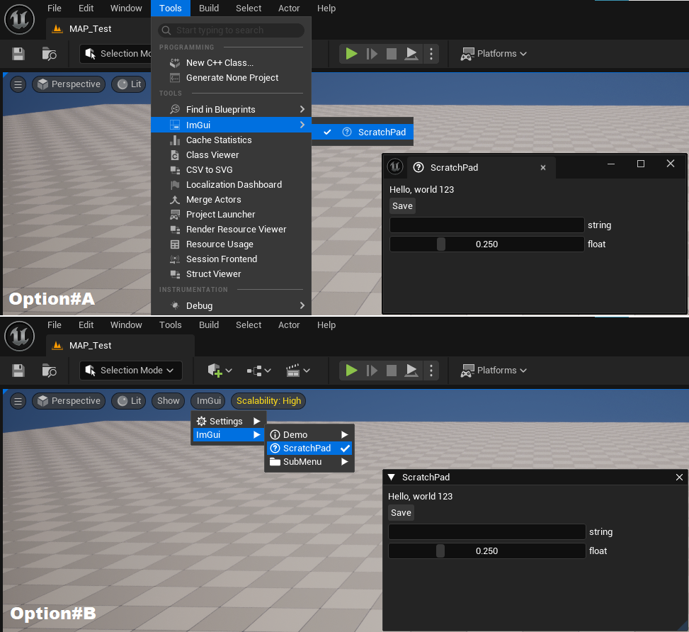
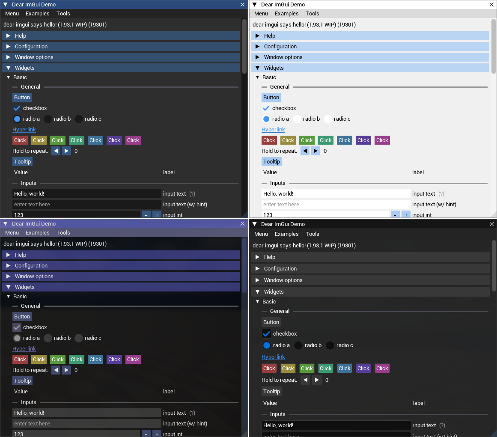
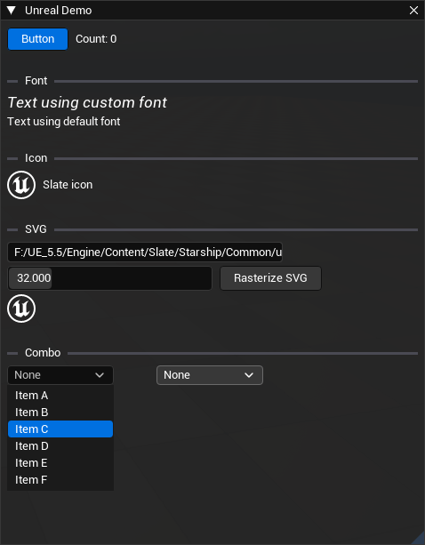
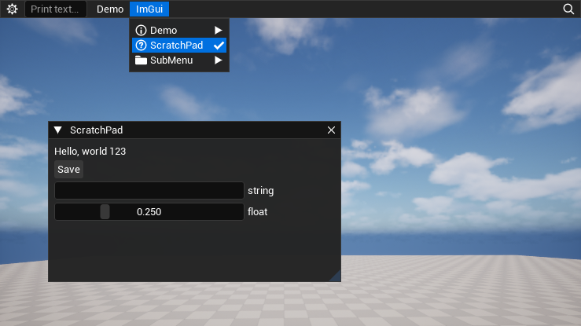

# ImGuiPlugin
A simple plugin for integrating [Dear ImGui](https://github.com/ocornut/imgui) in Unreal Engine 5.

## Features
The plugin stays up to date with latest ImGui releases and supports all the major features
* [Docking](https://github.com/ocornut/imgui/wiki/Docking)
* [Multi-Viewports](https://github.com/ocornut/imgui/wiki/Multi-Viewports)
* [Dynamic fonts](https://github.com/ocornut/imgui/issues/8465)
* [FreeType font loader](https://github.com/ocornut/imgui/tree/master/misc/freetype)
* [NetImGui](#netimgui)
* [Unreal themes](#unreal-themes)
* Support for Unreal textures and Slate brushes
* Native and Slate rendering path
* [MenuBar support](#menubar)

## Installation
* Clone the repo in Project/Plugins folder `git clone git@github.com:amuTBKT/ImGuiPlugin.git` <br>
  or download zip and extract under Project/Plugins folder.
* Include the plugin in your own modules.
* Feel free to use [ImGuiExamples](https://github.com/amuTBKT/ImGuiExamples) as reference.

### Static Lib
For editor builds the plugin also supports linking ImGui as a static library. This can improve performance when widgets make signficant amount of ImGui calls. <br>
Calling `Source/Thirdparty/ImGui/Build.bat` from MSVC command prompt (x64 Native Tools Command Prompt) should generate the required libs under "/ImGuiPlugin/Source/Thirdparty/ImGui/Binaries" directory. <br>
Make sure to regenerate project files or touch `Source/Thirdparty/ImGui/ImGui.Build.cs` in order to update the library dependency.

## Usage
Simple utility widget
```cpp
#ifdef WITH_IMGUI

#include "ImGuiPluginTypes.h"

namespace ImGuiScratchPad
{
    static void Tick(FImGuiTickContext* Context)
    {
        FImGuiTickScope Scope{ Context };

        static float f = 0.25f;
        static char buf[64] = { 0 };

        ImGui::Text("Hello, world %d", 123);
        if (ImGui::Button("Save"))
        {
        }

        ImGui::InputText("string", buf, IM_COUNTOF(buf));
        ImGui::SliderFloat("float", &f, 0.0f, 1.0f);
    }

    FImGuiWidgetRegisterParams Params =
    {
        .TickFunction = &Tick,
        .WidgetPath   = "ImGui.ScratchPad",
        .WidgetIcon   = IMGUI_STYLE_ICON("CoreStyle", "Icons.Help"),
    };

    // Option#A: to add a standalone widget
    IMGUI_REGISTER_STANDALONE_WIDGET(Params);

    // Option#B: to add the widget to level viewport toolbar
    IMGUI_REGISTER_MAIN_MENU_WIDGET(Params);
}

#endif //#if WITH_IMGUI
```

* Option#A creates a dockable window hosting the ImGui widget. Ideal for standalone tools.<br>
Please note, in packaged builds this fallbacks to Option#B
* Option#B creates a menu bar entry owned and managed by LevelViewport.
* `UImGuiSubsystem::RegisterMainMenuWidget` can be used to register widgets dynamically.
* `SImGuiWidget` works similar to any other Slate widget and can be added to level viewport, Slate windows or Slate containers.

### NetImGui
The plugin allows connecting to [NetImGui](https://github.com/amuTBKT/netImgui) server for remote drawing.<br>
Adding `-NetImGuiPort=PORT` to commandline should allow connecting from NetImGui server. In order to keep the setup simple connecting to server from app is not supported.<br>
NOTE: NetImGui is not supported in Editor/Program builds.

### Unreal themes
The plugin supports 4 themes which can be changed using `imgui.Theme` console variable
- `imgui.Theme 0` : For ImGui Dark theme
- `imgui.Theme 1` : For ImGui Light theme
- `imgui.Theme 2` : For ImGui Classic theme
- `imgui.Theme 3` : For Unreal theme (default)

`FImGui` namespace defines custom ImGui widgets for Unreal theme, designed to match Slate styling.


### MenuBar
The plugin allows registering widget to MenuBar owned by PIE/Editor contexts. In packaged builds there is only a single primary menu bar context available.


MenuBar widget tries to make switching b/w game and ImGui inputs seamless.

Keyboard shortcuts for toggling MenuBar and UI focus can be defined in `DefaultInput.ini`
```
[ImGuiPlugin]
ToggleMenuKeyChord=(Key=F2,bShift=True)
SetUIFocusKeyChord=(Key=F1,bShift=True)
```
UI focus simply makes the cursor visible and releases the mouse capture from game viewport.<br>
Toggle menu simply calls `imgui.ToggleMenu` console command. Clients can also call `serverexec imgui.ToggleMenu` to open the menu on server build. In editor this will open a standalone window hosting the ImGui widget, on packaged server NetImGui can be used to connect to the server build.
